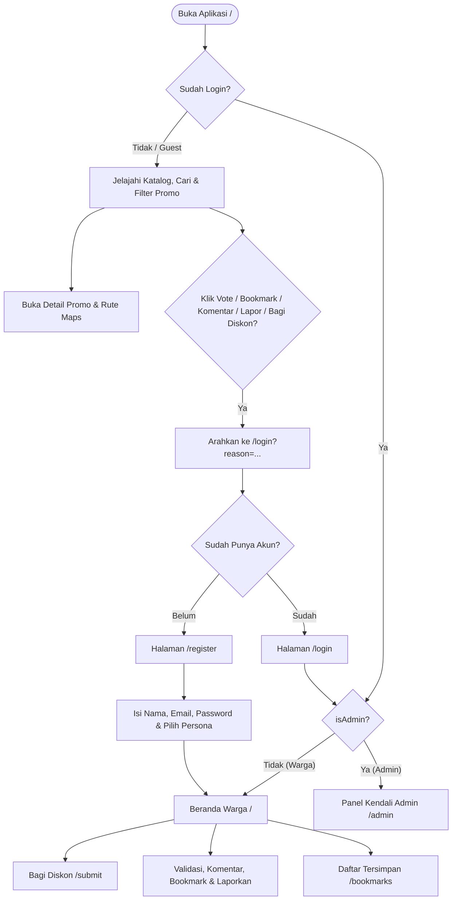

# 🔄 Dokumentasi Aplikasi & User Flow Temurah
## 📊 Diagram Alur Utama

---

## 1. Pengunjung Tanpa Login (*Guest*)

Saat pertama kali membuka beranda (`/`), pengguna berstatus **Guest** dan dapat langsung menikmati fitur pembacaan katalog:

1. **Deteksi Lokasi Otomatis (Opsional):**
   - Browser meminta izin lokasi (*Geolocation*). Jika diizinkan, sistem mendeteksi area sekitar; jika ditolak, katalog tetap menampilkan seluruh area tanpa error.
2. **Menjelajahi Katalog Promo:**
   - Melihat bagian **Paling Banyak Divalidasi Warga**, **Potongan Harga Terbesar**, dan **Promo Terbaru Masuk** (mendukung *Infinite Scroll* ala Shopee hingga seluruh promo habis).
   - Menggunakan kolom pencarian dan filter (Kategori, Tipe Toko, Wilayah/Radius).
3. **Melihat Detail Promo:**
   - Mengklik kartu promo untuk membuka `PromoDetailSheet` (melihat harga normal vs promo, deskripsi, foto bukti, komentar warga, serta tombol **Buka Rute** ke Google Maps).
4. **Batasan Aksi (*Auth Guard*):**
   - Jika Guest menekan tombol **Valid / Tidak Valid**, **Bookmark**, **Kirim Komentar**, **Laporkan (Flag)**, atau **+ Bagi Diskon** (`/submit`), fungsi `requireAuth` akan mencegat aksi dan mengarahkan pengguna ke `/login?reason=...` dengan pesan alasan yang jelas.

---

## 2. Registrasi Akun Baru (`/register`)

Pengguna yang belum memiliki akun dapat mendaftar melalui halaman `/register`:

1. Mengisi formulir pendaftaran:
   - **Nama Lengkap** (minimal 2 karakter)
   - **Email** (valid & unik)
   - **Kata Sandi** & **Konfirmasi Kata Sandi** (minimal 6 karakter, harus cocok)
   - **Peran / Persona Komunitas:** Memilih salah satu peran (*Mahasiswa*, *Pekerja / Karyawan*, *Ibu Rumah Tangga*, *Pemilik UMKM / Usaha*, atau *Pencari Diskon Umum*).
2. Sistem memvalidasi input dengan Zod, melakukan *hashing* kata sandi menggunakan `bcryptjs`, menyimpan user ke PostgreSQL, lalu membuat cookie sesi JWT (`jose`).
3. Pengguna otomatis masuk dan diarahkan ke beranda (`/`).

---

## 3. Login (`/login`)

1. Pengguna memasukkan **Email** dan **Kata Sandi** pada halaman `/login`.
2. Sistem memverifikasi kredensial dan memeriksa status akun:
   - Jika akun berstatus `isBanned: true`, login ditolak dan menampilkan alasan pemblokiran.
   - Jika valid:
     - **Warga Biasa (`isAdmin: false`):** Diarahkan ke beranda (`/`).
     - **Administrator (`isAdmin: true`):** Otomatis diarahkan langsung ke **Panel Kendali Admin (`/admin`)**.

---

## 4. Aktivitas Pengguna Terautentikasi (*Warga*)

Setelah login, pengguna memiliki akses penuh ke seluruh fitur komunitas:

### A. Membagikan Diskon Baru (`/submit`)
1. Klik tombol **+ Bagi Diskon** di header.
2. Pilih **Jenis Toko**:
   - **Toko Fisik / Offline:** Pilih kategori toko (*Supermarket, Pasar Tradisional, Minimarket, dll*), isi nama toko, alamat, dan tentukan titik koordinat melalui **Peta Lokasi Interaktif**.
   - **Toko Online / Marketplace:** Pilih platform (*Shopee, Tokopedia, Lazada, TikTok Shop, dll*) dan masukkan tautan/nama toko.
3. Isi detail produk: Nama produk, kategori, harga normal, harga promo, kondisi stok, tanggal & jam kedaluwarsa.
4. Unggah foto bukti (struk belanja atau label harga). Gambar otomatis dikompresi ke format **WebP** di browser sebelum diunggah ke **Cloudinary**.
5. Klik kirim; promo langsung tampil di katalog beranda.

### B. Validasi, Komentar & Bookmark
- **Valid / Tidak Valid:** Memberi suara validasi langsung dari kartu promo (`PromoCard`) atau dari detail sheet (`PromoDetailSheet`).
- **Komentar:** Menulis komentar diskusi di detail promo serta dapat menghapus komentar miliknya sendiri.
- **Bookmark:** Menyimpan promo favorit dengan ikon pita (`Bookmark`) dan melihat seluruh daftar tersimpan di halaman `/bookmarks`.

### C. Melaporkan Konten (`ReportModal`)
- Jika menemukan promo palsu, stok habis, spam, atau komentar kasar:
  - Klik ikon **Bendera (Flag)** pada pojok kanan atas kartu promo, di header detail promo, atau di samping komentar.
  - Pilih alasan pelanggaran, tambahkan catatan opsional, lalu kirim. Laporan masuk ke antrean Admin dengan status `PENDING`.

### D. Logout
- Pengguna dapat keluar melalui menu profil di `HeaderNav`, yang akan menghapus cookie sesi JWT dan mengembalikan status ke *Guest*.

---

## 5. Alur Administrator (`/admin`)

Akun dengan `isAdmin: true` memiliki akses khusus ke `/admin` (link dashboard hanya muncul di menu profil Admin):

1. **Chart & Ringkasan:** Memantau statistik pengguna, promo aktif, total validasi, komentar, serta grafik tren 7 hari terakhir.
2. **Laporan Warga (Moderasi):**
   - Melihat daftar laporan masuk beserta alasan, pelapor, dan konten target.
   - Mengambil tindakan: **Hapus Postingan Promo**, **Hapus Komentar**, **Ban Pembuat Konten**, **Tandai Selesai (`RESOLVED`)**, atau **Abaikan (`DISMISSED`)**.
3. **Kelola User:** Melihat daftar pengguna dan melakukan *Ban / Unban* akun.
4. **Master Platform & Kategori:** Menambah, mengaktifkan/menonaktifkan, atau menghapus daftar platform online dan kategori produk.

---

## 🔑 Kredensial Akun Uji Coba (Testing)

Berikut adalah akun default yang tersedia setelah menjalankan seeder (`pnpm prisma:seed` dan `pnpm prisma:seed:demo`):

### 1. Akun Administrator
Digunakan untuk menguji fitur moderasi laporan, statistik dashboard, serta manajemen user & master data di `/admin`:
- **Email:** `admin@temurah.com`
- **Password:** `adminpassword123`

### 2. Akun User Warga (Demo Test)
Digunakan untuk menguji fitur warga biasa (berbagi diskon, validasi, komentar, bookmark, dan laporkan konten). Semua akun demo di bawah ini menggunakan password yang sama:
- **Password:** `demo12345`

| Nama | Email | Peran / Persona |
| :--- | :--- | :--- |
| Siti Rahmawati | `siti.rahma@demo.temurah.id` | Ibu Rumah Tangga |
| Budi Santoso | `budi.santoso@demo.temurah.id` | Pekerja / Karyawan |
| Rizky Ramadhan | `rizky.mhs@demo.temurah.id` | Mahasiswa |
| Hj. Endang Suryani | `bu.endang@demo.temurah.id` | Ibu Rumah Tangga |
| Dimas Prasetyo | `dimas.tech@demo.temurah.id` | Pekerja / Karyawan |
| Anisa Putri | `anisa.ugm@demo.temurah.id` | Mahasiswa |
| Pak Warno Kios | `warno.pedagang@demo.temurah.id` | Pemilik UMKM / Usaha |
| Dewi Lestari | `dewi.lestari@demo.temurah.id` | Pencari Diskon Umum |
| Agus Pratama | `agus.pratama@demo.temurah.id` | Pemilik UMKM / Usaha |
| Maya Anggraini | `maya.deal@demo.temurah.id` | Pencari Diskon Umum |
